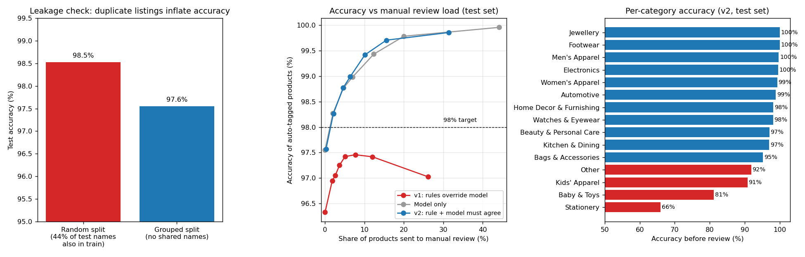

# Product Categorisation: rules + ML + manual review (Flipkart, 20,000 products)

Maps marketplace products into a client's own category structure using RegEx rules, a text
classifier and a confidence-based manual-review queue, then audits the result the way a
backtest is audited: data checks, leakage test, train/validation/test discipline, and
accuracy per category.



## Result in one paragraph
On a held-out test set with **no product name shared with training**, the system auto-tags
**99% of products at 98.1% accuracy and sends 1% to manual review** (threshold chosen on the
validation set, not the test set). Tightening the threshold trades review effort for accuracy:
**99.4% accuracy with 10% reviewed**, or **99.7% with 16% reviewed**. The first design, where
rules overrode the model, was worse than the model alone; the fix was found using
training and validation data only.

## The task
A hypothetical fashion and lifestyle retail client groups products into 15 categories that do
not match Flipkart's tree (for example, Watches + Sunglasses = "Watches & Eyewear"; clothing is
split into Men's, Women's and Kids'). Flipkart's category tree is mapped to these categories
and used **only as the answer key**. Every method sees only the product name, brand and
description.

## 1. Data checks
| Check | Finding |
|---|---|
| Rows | 20,000 products |
| Broken category trees | 336 rows (1.7%) have a product name where the top-level category should be. Excluded from scoring and reported. |
| Missing brand | 29% overall; 84% for watches and 78% for beauty, even though the brand usually appears in the product name. A brand-extraction step would recover most of them. |
| Duplicate listings | 7,324 rows repeat an earlier product name (size and colour variants). Only 12,419 distinct products. |

## 2. Leakage check
Duplicate listings make a random train/test split dishonest: **44% of test rows had the same
product name in training**, and accuracy looked like **98.5%**. Splitting by product name so
no product appears on both sides gives the honest figure: **97.6%**. All results below use the
grouped split (train 12,701 / validation 2,959 / test 4,004).

## 3. Rules alone (RegEx on product name)
11 rules written from domain knowledge cover 57% of products at 96% precision overall. But on
training and validation data, three rules were unreliable:

| Rule | Precision (train + val) | Why |
|---|---|---|
| Stationery (pen, pencil, notebook) | 47% | The client's "Baby & Toys" includes school supplies, so a kid's pencil box is not "Stationery". |
| Kids' apparel (boy's, girl's) | 75% | Baby clothing sits under Baby Care in the source tree. |
| Furnishing (blanket, towel) | 81% | Baby blankets and towels again belong to Baby & Toys. |

## 4. Two designs compared
- **v1: rules override the model.** Rule outputs were treated as certain, so their mistakes
  could never reach the review queue. Accuracy fell to 96.3%, below the model alone (97.6%),
  and no threshold reached the 98% target.
- **v2: rules and model must agree.** Decided from training and validation evidence before
  re-scoring the test set: keep only rules with at least 95% precision; if a rule and the model
  agree, auto-tag (49% of products, 99.8% accurate); if they disagree, send to review; otherwise
  the model's confidence decides.

| Review threshold | Sent to review | Accuracy of auto-tagged |
|---|---|---|
| 0.37 (chosen on validation for a 98% target) | 1.0% | 98.1% |
| 0.80 | 6.4% | 99.0% |
| 0.90 | 10.1% | 99.4% |
| 0.95 | 15.6% | 99.7% |

Compared with the model alone, the agreeing rules cut the review load by about 20% at the same
accuracy (10.1% vs 12.4% reviewed at 99.4%; 15.6% vs 20.0% at 99.7%).

## 5. Where it is weak
| Category | Accuracy before review | Main confusion |
|---|---|---|
| Stationery | 66% | Confused with Baby & Toys (school supplies) |
| Baby & Toys | 81% | Products predicted as Stationery or Kids' Apparel |
| Kids' Apparel | 91% | Baby clothing |
| Other | 92% | A mixed "catch-all" category |

These are **category-definition problems more than model problems**: the boundary between
"school supplies", "baby clothing" and their adult equivalents needs a client decision. In a
real engagement the next step is to agree those rules with the client, not to tune the model.

## SQL
`run_sql.py` loads the data into SQLite and runs `queries.sql`: broken-tree check, ground-truth
labels through a mapping-table join (19,664 rows, identical to the Python pipeline), missing
brands by category, accuracy and review load per category, today's review queue, and top
confusions using a window function.

## Run it
```
pip install pandas scikit-learn matplotlib
python pipeline.py      # about 3 minutes; writes report.json and test_predictions.csv
python run_sql.py       # SQL checks and reports
python make_chart.py    # chart.png
```
Files: `taxonomy.py` (client categories, mapping, RegEx rules), `pipeline.py`, `queries.sql`,
`run_sql.py`, `make_chart.py`.

Model: TF-IDF on words (1–2 grams) and characters (3–5 grams) with logistic regression, settings
fixed in advance. Data: Flipkart Products dataset (PromptCloud, Kaggle). Check its licence before
redistributing the CSV.
